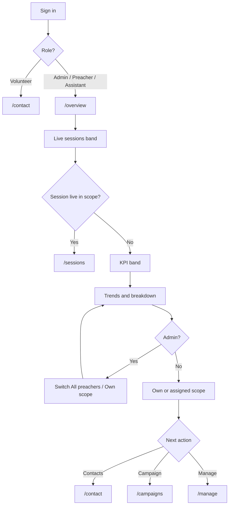

# 01-staff-program-overview

**Project:** folk_hkmc
**Created:** 2026-11-01
**Method:** Whiteport Design Studio (WDS)
**Status:** specified

---

## Scenario Overview

**User Journey:** A programme coordinator signs in and, before opening any other screen, sees how the programme is doing: how many contacts exist, how many sessions have run, how many people attended, whether a session is live right now, which preacher is carrying the work, and where the current campaign stands. An Admin can flip the same page between the whole programme and their own rows without losing the page.

**Entry Point:** The `Dashboard` item in the staff header, or the post-sign-in landing for Admin, Preacher and Assistant.
**Success Exit:** The reader has answered "what is happening, and what needs me now" and moved to the surface that acts on it — `/sessions`, `/campaigns`, `/contact` or `/manage`.
**Alternative Exits:** Volunteer is sent to `/contact` at sign-in and never sees the page. An Assistant with no active assigned preacher sees an explanatory empty page rather than a refusal. A failed data read is a 500; a failed role gate is `/auth/error?code=staff-authorization-failed`.

**Target Personas:**
- **Admin** — owns the programme, needs every preacher's numbers and the ability to narrow to their own rows.
- **Preacher** — needs their own contacts, sessions and attendance without programme-wide noise.
- **Assistant** — works through one preacher; sees that preacher's rows, read-only.

No Trigger Map exists in this repository. The drivers below are taken from the programme-operations context in `_bmad-output/specs/spec-manage-dashboard-grid/SPEC.md` and the Campaign spec.

---

## Pages in This Scenario

| Page # | Page Name | Status    | Purpose                                                                 |
| ------ | --------- | --------- | ----------------------------------------------------------------------- |
| 01.1   | Dashboard | specified | Programme-wide or own-scope overview of contacts, sessions, attendance, preachers and campaigns. |

---

## User Flow



---

## Scenario Steps

### Step 1: Land

**Page:** 01.1 Dashboard
**User Action:** Signs in, or taps `Dashboard` in the header.
**System Response:** Resolves the role's scope and renders the page in that scope. Admin defaults to `All preachers`; Preacher and Assistant always narrow.
**Success Criteria:** The page renders in under the same navigation budget as `/manage`, with every number already in its role's scope — no flash of programme-wide data before narrowing.

### Step 2: Scan for a live session

**Page:** 01.1 Dashboard
**User Action:** Looks at the top of the page.
**System Response:** If a session is live in scope, a band names it, its preacher, its locations, its closing time and its current check-in count, refreshing every 20 s while the tab is visible. If nothing is live, the band is absent — no placeholder.
**Success Criteria:** A live session is identifiable in one glance and its count matches `/sessions`.

### Step 3: Read the numbers

**Page:** 01.1 Dashboard
**User Action:** Reads the KPI band, the two trend charts, the breakdown table and the recent-session list.
**System Response:** Every figure is derived from the same scoped rows the destination pages read.
**Success Criteria:** The reader can state contacts, sessions, attendees and attendance without opening another page, and each figure agrees with the page that owns it.

### Step 4: Narrow to own scope (Admin only)

**Page:** 01.1 Dashboard
**User Action:** Taps `Own scope` in the scope switch.
**System Response:** Navigates to `/overview?mode=preacher`; every section re-reads in the Admin's own scope, using the same predicate `/manage` uses.
**Success Criteria:** The switch is a real navigation, the URL is shareable, and no section keeps a programme-wide number.

### Step 5: Act

**Page:** 01.1 Dashboard
**User Action:** Follows `Open Sessions`, `Open Campaigns`, `Add contact` or `Manage`.
**System Response:** The destination opens in its own scope rules.
**Success Criteria:** The destination's scope matches the scope the reader was in, or the reader is told why it cannot.

---

## Navigation Change

The Dashboard becomes the first staff destination. The required order is:

`Dashboard · Contact · Sessions · Invite · Campaign · Manage`

This differs from today in two ways: `Dashboard` is new and first, and `Manage` moves from before `Campaign` to last. The full role matrix and the implementation notes live in [the page specification](pages/01.1-dashboard/01.1-dashboard.md#navigation--shell-changes).

---

## Success Metrics

**Primary Metric:** A coordinator can answer "how many contacts, sessions and attendees; is anything live; which preacher is carrying the work" without leaving `/overview`.

**Secondary Metrics:**

- Scope switch reaches its new state in one navigation, with the URL carrying it.
- The KPI band and the breakdown table never disagree for the same scope.
- No destination page shows a different scope from the one the reader left.

**User Satisfaction Indicators:**

- The page is read top-down in one scroll; no number needs a tooltip to be understood.
- The live band is the first thing seen on a session day, and absent on a quiet day.

---

## Edge Cases & Error Handling

| Edge Case | How Handled | Page(s) Affected |
| --------- | ----------- | ---------------- |
| Fresh programme — no contacts, no sessions | One onboarding card replaces the trend, breakdown, campaign and recent cards; KPI row reads 0. | 01.1 |
| Own scope holds nothing | Explanatory card; Admin gets a `Switch to All preachers` action; Preacher and Assistant get instructions instead. | 01.1 |
| Assistant with no active assigned preacher | Empty scope and an explanatory notice; the page does not refuse. | 01.1 |
| Assistant whose assigned preacher became inactive | Treated as no assignment, matching `/sessions`. | 01.1 |
| Two or more sessions live at once (Admin, all preachers) | The band lists each live session, up to three, newest first. | 01.1 |
| More than three live sessions | The band lists the three newest and a `+N more` line linking to `/sessions`. | 01.1 |
| Live-count refresh fails | The last counts stay visible with `Could not refresh live counts.` and a `Retry` action. | 01.1 |
| Campaign module off (Gita Life) | The Campaign section and the `Active campaigns` tile are absent; the KPI grid is four tiles. | 01.1 |
| Campaign scope missing (Assistant, no preacher) | The Campaign section renders its empty state; the page does not fail. | 01.1 |
| A malformed `?mode=` value | Coerced to `admin` for an Admin, exactly as `/manage` does; RLS remains the enforcement point. | 01.1 |
| Read failure | 500 (thrown), not a role-blame redirect. | 01.1 |
| Session at exactly its closing time | Not live, matching the existing predicate used by `/sessions` and `/dashboard`. | 01.1 |

---

## Technical Requirements

### Data Flow

```
Request /overview?mode=<admin|preacher>
  → getStaffContext()
  → requireRole([Admin, Preacher, Assistant])
  → resolve scope (role + mode + assigned preacher)
  → loadOverviewData({ staff, mode })
      → paged reads: contacts, sessions, attendance, locations, users
      → listCampaignsWithProgress(staff, scopeOverride)
  → render server payload
  → client: live-count refresh every 20 s while visible
```

### Endpoints Used

| Endpoint | Page(s) | Purpose |
| -------- | ------- | ------- |
| `GET /attendance?session=<id>` | 01.1 | Live check-in count per live session. Existing endpoint; no new route. |
| `/api/auth/me` | 01.1 | The auth context already calls it; unchanged. |

No new HTTP endpoint is introduced. The route is a server component that resolves scope and loads the payload; the live band and the two Recharts charts are client components fed by that serialisable payload.

### State Management

- Scope is URL state (`?mode=`), never client-only, because it changes what the server reads.
- Live counts are client state seeded by the server payload.
- No filters, sorting or pagination on this page. Every list is a fixed, server-ordered top-N.

---

## Design Assets

**Scenario Folder:** `C-UX-Scenarios/01-staff-program-overview/`

**Page Specifications:**

- [01.1-dashboard](pages/01.1-dashboard/01.1-dashboard.md)

**References (existing app, not new art):**

- `_bmad-output/E-Assets/page-designs/references/desktop-manage-dashboard.png`
- `_bmad-output/E-Assets/page-designs/references/mobile-light-manage-dashboard.png`

---

## Development Notes

- The shared header (`components/header.tsx`) is used by both apps. The Dashboard item must resolve to a route that exists in both `apps/folk` and `apps/gita-life`, or be gated by a profile module. This scenario adds `/overview` to both.
- The post-sign-in landing change touches `components/auth-hash-callback.tsx`, both `login-page-client.tsx` files, and `e2e/fixtures/roles.ts`. The e2e fixture is the app's mirror of the landing table; it must change in the same commit or every authenticated setup fails loudly.
- `/dashboard` is left untouched. It remains the live-attendance surface, is not in the nav, and is a retirement candidate once `/sessions` fully owns live attendance.

---

## Revision History

| Date       | Changes                  | Author |
| ---------- | ------------------------ | ------ |
| 2026-11-01 | Initial scenario created | Freya  |

---

_Created using Whiteport Design Studio (WDS) methodology_
