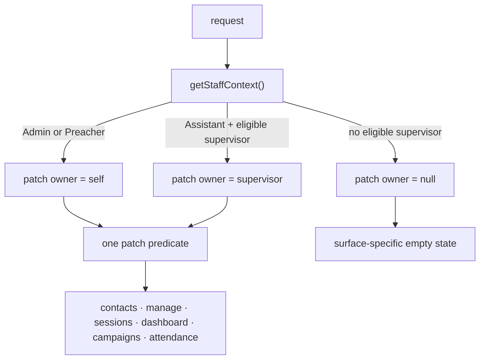

# Architecture Spine — Staff scope: Admin supervisors and Assistant surfaces

One supervisor rule, one patch predicate, one surface matrix. The decisions that keep the invite path, the scope resolvers, the manage/contacts surfaces, the attendance reads and RLS from diverging.

**Patch** in this spine means a staff member's personal scope: the contacts they own, the sessions they created or preached, and their locations. It is not an HTTP `PATCH`.

**Supervisor** is an internal shorthand in this spine for the assigned Preacher — an Active Preacher or Admin. It is not a staff role and never appears in user-facing copy; the UI label stays "Preacher" for both.

`[ADOPTED]` marks a decision the user or existing reality already settled; the rest are this spine's calls.

## Design Paradigm

**A single patch-owner resolver inside the layered App Router monolith.** `getStaffContext()` is the only identity read. It resolves the caller's *patch owner* once: the caller for an Admin or Preacher, the assigned supervisor for an Assistant, `null` otherwise. Every operational page, route handler, scope resolver and SQL call reads and writes through that owner. No surface re-derives the supervisor, resolves `assigned_preacher_id` itself, or substitutes the actor for the owner; it uses `patchOwner` and, where attribution is needed, `actor`.

Inherited, not re-decided: the staff identity boundary, program scoping, service-role-only writes and the four-role vocabulary from `docs/architecture.md`. `/campaigns/**` keeps the autodialer spine's AD-2 split between the admin surface and the caller surface; this spine updates the admin scope helper to read the patch owner and changes nothing else there. Dashboard and sessions scope predicates stay as their specs define them; only the owner changes.



## Invariants & Rules

### AD-1 — The patch owner is resolved once, at the staff boundary

- **Binds:** `lib/authz.ts`; `components/staff-auth-shell.tsx`; `apps/*/app/api/auth/{me,complete-implicit,signin}/route.ts`; `lib/auth-context.tsx`; every page, handler and scope resolver that calls `getStaffContext()`
- **Prevents:** each surface re-reading `public.users` and disagreeing on eligibility; an Assistant's scope changing between `/dashboard`, `/sessions`, `/campaigns` and `/manage`; the RSC `initialStaff` prop or an auth route shipping the supervisor's location list; the header and the page disagreeing about whether an Assistant has a patch.
- **Rule:** `getStaffContext()` returns a **server-only** `patchOwner`:
  - `{ userId, role: 'Admin' | 'Preacher', name, locationIds }` for an Admin or Preacher — the caller's own row;
  - the same shape for an Assistant when the row at `assigned_preacher_id` exists, is `Active`, is in the same programme, and has role `Admin` or `Preacher`;
  - `null` for an Assistant without an eligible supervisor, and for a Volunteer.

  The supervisor row is read with the admin client, because `public.users` RLS lets a non-Admin read only their own row. `assignedPreacherUserId` remains the raw FK. No page, handler or scope resolver may call `findStaffUserById` to resolve a supervisor **for scope**; the invite and contact write paths may read the chosen row to validate it, which is a write check, not a scope read.

  One `toClientStaff()` projection serves `/api/auth/me`, `/api/auth/complete-implicit`, `/api/auth/signin` and every `StaffAuthShell`. It keeps the existing client fields (`name`, `email`, `role`, `hasActiveCallerProfile`) and adds `hasPatchScope`, `supervisorName`, `supervisorRole` (both null for an Admin/Preacher or an Assistant without a supervisor) and the nav capability flags (`canReadContacts`, `canManage`, `canInviteVolunteers`, `canUseCampaignAdmin`, `canUseCallerQueue`); it never carries `patchOwner.locationIds`. The header reads the capability flags, never `isPreacher`, to decide an Assistant's items.

### AD-2 — An Admin may supervise an Assistant, and the binding has one lifecycle `[ADOPTED]`

- **Binds:** `apps/*/app/api/admin/invite-user/route.ts`, `apps/*/app/api/volunteers/invite/route.ts`, `components/invite-user-form.tsx`, `lib/supabase/data.ts`, `upsertStaffUser()`
- **Prevents:** an Admin never appearing as a supervisor; a Preacher binding an Assistant to someone else; a promoted Preacher keeping the old supervisor's RLS scope; a demoted Volunteer losing their form routing; two invite routes with different eligibility checks.
- **Rule:**
  - An eligible supervisor is an `Active` user in the same programme with role `Admin` or `Preacher`.
  - An Admin may bind an Assistant to any eligible supervisor, including moving an existing Assistant. A Preacher may bind only to themselves. An Assistant or Volunteer cannot invite.
  - Binding lifecycle by destination role:
    - **Admin or Preacher:** clear `assigned_preacher_id`.
    - **Assistant:** require an eligible Admin or Preacher.
    - **Volunteer:** require an eligible Preacher; if the current supervisor is an Admin, clear it and require a Preacher. The binding is the Volunteer's form routing, not a scope grant.
  - Both invite paths use one `resolveEligibleSupervisor()` helper. `upsertStaffUser()` needs an explicit null path; omitting the field is not a clear.
  - `/volunteers` and `/api/volunteers/invite` are the Preacher's surface and stay self-only; an Admin invites from `/admin/invite`. The administrator's invite path may move an existing Assistant; the Preacher's surface may not. Only an Admin may demote an existing Assistant to Volunteer; the Preacher's surface refuses the downgrade.
  - A supervisor move changes the patch for future reads; it does not rewrite historical `preacher_id` or `assigned_preacher_id` rows. Historical work stays with the old supervisor and leaves the new supervisor's dashboard.
  - A missing or ineligible binding at read time yields `patchOwner = null` (AD-1), never a widening and never a refusal at the read boundary; the surface's null-patch state is AD-4.

### AD-3 — One patch predicate, one actor/owner vector `[ADOPTED]`

- **Binds:** `lib/supabase/manage.ts`, `lib/contacts/section-server.ts`, `lib/dashboard/scope.ts`, `lib/sessions/scope.ts`, `lib/sessions/data.ts`, `lib/dialer/scope.ts`, `apps/*/app/api/{sessions,contact,manage}/**`, `components/manage/*`
- **Prevents:** an Assistant reading programme rows; an Assistant's own write vanishing from their patch; the app and RLS disagreeing about what the patch contains; a draft row showing the actor as owner; an Admin's programme view collapsing to a personal patch; a scope function receiving the owner's role and widening an Assistant.
- **Rule:** for `owner = patchOwner` and `actor = staff.userId`:
  - contacts: `assigned_preacher_id = owner.userId` on the grid and manage surfaces;
  - sessions: `preacher_id = owner.userId OR created_by = owner.userId OR created_by = actor`; for a Preacher, also `created_by IN (active staff assigned to owner)`, the existing assistant-created term;
  - attendance: through a session in the patch;
  - locations: `owner.locationIds` for the picker and every write check in personal mode; an Admin's programme mode uses the programme location set;
  - grid writes: on **create**, `assigned_preacher_id` (contact) and `preacher_id` (session) carry `owner.userId`, and `collected_by_id`/`created_by` carry `actor`. On **update**, ownership and collector are preserved; an edit is not a reassignment.

  **Scope vector.** An app-level scope function receives `p_actor_id`, `p_actor_role`, `p_owner_id` and `p_owner_location_ids`; it never receives the owner's role. `sessions_visible` and every scope resolver take the full vector. `caller_can_read_attendance_session()` is an RLS helper: it is called with one argument and resolves actor and owner from `auth.uid()` and `caller_assigned_preacher_id()`. `dashboard_overview` and `campaign_progress` are owner-only by decision; an Assistant's own created sessions are stamped `preacher_id = owner`, so they are included without an actor parameter.

  **Admin exception.** An Admin's programme scope stays the programme: `/manage` in `mode=admin`, `/dashboard` by default, `/contacts` and `/sessions` personal, `/attendance` programme, campaigns `{kind:"program"}` with a creator-only campaign list. The per-surface matrix is AD-4. An Assistant never receives `program_scope = true` or `kind:"program"`.

  **Campaigns.** For a Preacher or Assistant, `campaignScope` is `{kind:"preacher", userId: owner.userId}`. Its assignable caller set is the active staff assigned to the owner, plus the actor and the owner. This amends the autodialer spine's AD-3 assignable set for an Assistant by adding the owner; the rest of AD-3 stands. The campaign list stays creator-only for an Admin.

  **Null owner.** A null owner yields zero rows on every operational surface, including the actor's own creations. This is a change from today's sessions fallback; the pre-deploy audit (Deferred) counts the affected rows. Client payloads carry the actor and the owner separately: `actorUserId`/`actorName` and `patchOwnerId`/`patchOwnerName`; `role` and `mode` are view descriptors, not capability or identity.

  **`/contact` form.** The grid write rule above does not apply to `/contact` or `/api/contact`. The form keeps its existing per-role assignment and collector rule (AD-4), with one eligibility change: an Assistant of an Admin resolves the Admin as supervisor. The Admin's explicit picker stays Preacher-only. The collector meaning is not unified with the grid's in this change.

### AD-4 — Assistant surfaces, role sets and the null-patch matrix `[ADOPTED]`

- **Binds:** `apps/folk/app/{contacts,manage,sessions,dashboard,campaigns,contact,attendance}/**`, `apps/*/app/{contacts,manage,sessions,dashboard,contact,attendance}/**`, `apps/*/app/api/{manage/contacts,sessions,contact}/**`, `apps/*/proxy.ts`, `components/header.tsx`, `lib/manage/api-handlers.ts`, `lib/contacts/section-server.ts`
- **Prevents:** an Assistant gaining the grid but not its write API; a page admitting Assistant while its handler refuses; the nav hiding a surface the page allows or showing one it refuses; a future surface inventing a fourth role list; a newly admitted route outside the session-refresh matcher; a Volunteer losing the caller queue.
- **Rule:** the role sets are defined once and used by both a page and its handlers:
  - `OPERATIONAL_ROLES = ["Admin", "Preacher", "Assistant"]` — `/contacts`, `/manage`, `/sessions`, `/dashboard`, the `/attendance` GET, and `/api/manage/contacts/**`.
  - `CAMPAIGN_ADMIN_ROLES = ["Admin", "Preacher", "Assistant"]` — `/campaigns` overview, new, reports, callers, assign-contacts and `/api/dialer/admin/**`; `requireCampaignAdmin` uses this set.
  - `CAMPAIGN_CALLER_ROLES` — any role with an active `dialer_callers` profile — `/campaigns/assignments` and `/api/dialer/caller/**`; the caller path scopes through assignments, not `patchOwner`.
  - `CONTACT_FORM_ROLES = ["Admin", "Preacher", "Volunteer", "Assistant"]` — `/contact` and `/api/contact`. The form's assignment rule: Volunteer → Preacher; Assistant → their supervisor (Admin or Preacher); Preacher → self; Admin → explicitly chosen Preacher. The collector keeps its existing per-role rule.
  - `VOLUNTEER_INVITE_ROLES = ["Preacher"]` — `/volunteers` and `/api/volunteers/invite`; self-only.
  - `STAFF_ADMIN_ROLES = ["Admin"]` — `/admin/**`, location creation, caller deactivation, and staff role/status changes outside the two invite surfaces.

  **Surface matrix**

  | Surface | Admin | Preacher | Assistant | Null patch |
  | --- | --- | --- | --- | --- |
  | `/contacts` | self | self | owner | empty + explanation |
  | `/manage` | programme (`mode=admin`) or self (`mode=preacher`) | self + assistant-created | owner + actor | empty + explanation |
  | `/sessions` | self, creator-only | self + assistant-created | owner + actor | empty + explanation |
  | `/dashboard` | programme, or self with `?mode=preacher` | self | owner | existing unassigned notice |
  | `/campaigns` admin | programme, creator-only list | owner | owner | autodialer 403 |
  | `/campaigns/assignments` | active caller profile | active caller profile | active caller profile | active caller profile |
  | `/attendance` GET | programme | owner | owner | empty |
  | `/contact` | chosen Preacher | self | owner | routing-not-configured error |

  The loader is the `mode` authority: `mode = staff.role === "Admin" ? resolveManageMode(query) : "preacher"`, and the app filter derives from the caller, not the query. A Preacher's `?mode=admin` is ignored. An Assistant's `/manage` payload is always `mode:"preacher"`, `role:"Preacher"` as a view descriptor, even when the supervisor is an Admin.

  **`/attendance`.** The staff GET is session-scoped or patch-scoped. Without a `session` parameter, a non-Admin's date read is patch-scoped; an Admin's is programme-scoped. An Admin's `?session=` read is programme-scoped and must not use the creator-only `sessions_visible` page filter. The public attendance POST stays session-window scoped and is not a staff read.

  **Nav.** The header uses the AD-1 capability flags. An Assistant with a patch gets Contacts and Manage; without one, neither is shown. Sessions and Dashboard remain with their explanations. Campaign follows the autodialer spine, including its 403 for a null scope; Invite is never shown to an Assistant.

  **Matcher and surfaces.** `apps/folk/proxy.ts` and `apps/gita-life/proxy.ts` gain `/manage/:path*`, `/api/manage/:path*`, `/admin/:path*` and `/attendance`. `/api/sessions` POST uses `patchOwner` for the owner and locations and does not re-resolve the supervisor or require a Preacher; a null patch is refused.

  This supersedes the autodialer spine's AD-13 sentence that fixes `/api/manage/contacts/**` at `["Admin", "Preacher"]`; the autodialer file and `docs/architecture.md` role matrix must be updated in the same change. The manage write gate must equal `OPERATIONAL_ROLES`, asserted by a test or the coverage matrix. The Campaign admin/caller split and the AD-2 role set are unchanged.

### AD-5 — RLS grants the patch; a page may narrow it, never widen it

- **Binds:** `supabase/migrations/**` — `caller_assigned_preacher_id()`, `caller_effective_location_ids()`, `caller_can_read_attendance_session()`, `sessions_visible`, the contacts/sessions/attendance/locations policies; every user-scoped and service-role staff read
- **Prevents:** the app showing a row the database refuses; a service-role read widening beyond the patch; a `/manage` attendance view that disagrees with `/sessions`; an Assistant or a promoted Preacher inheriting the wrong supervisor's rows; a cross-programme assignment resolving.
- **Rule:** the RLS helpers and policies grant the AD-3 patch. The Admin branch of every policy stays `caller_role() = 'Admin'` and programme-wide; do not narrow it to a personal patch.
  - `caller_assigned_preacher_id()` and `caller_effective_location_ids()` require the assigned row to be `Active`, in the same programme, and role in (`Preacher`, `Admin`). An ineligible assignment returns null/empty, matching `patchOwner = null`. The Volunteer branch of the locations helper remains the form's reference list, not a patch.
  - The Assistant branch of the contacts policy is `assigned_preacher_id = caller_assigned_preacher_id()`, keeping the programme term and the other role branches.
  - The Assistant branch of the sessions policy is `owner IS NOT NULL AND (preacher_id = owner OR created_by = owner OR created_by = actor)`; it drops `preacher_id = actor` and keeps `created_by = actor`. The Preacher branch keeps `created_by IN (active staff assigned to owner)`. Every `caller_assigned_preacher_id()` term is gated on `caller_role() = 'Assistant'`.
  - `sessions_visible` implements the same boolean: Admin `created_by = actor`; Preacher `preacher_id = owner OR created_by = owner OR created_by IN (active staff assigned to owner)`; Assistant `owner IS NOT NULL AND (preacher_id = owner OR created_by = owner OR created_by = actor)`. A null owner yields zero rows.
  - `caller_can_read_attendance_session()` matches the session predicate exactly: Admin any session in the programme; Preacher `preacher_id = self OR created_by = self OR created_by IN (active staff assigned to self)`; Assistant `owner IS NOT NULL AND (preacher_id = supervisor OR created_by = supervisor OR created_by = self)`.
  - A page may apply a narrower filter than RLS (the Admin's `/sessions` is creator-only today); it may never widen. For the same role and patch, `/manage` uses the same session predicate as `/sessions`; the Admin's `/sessions` creator-only filter is the only documented narrowing. RLS is not narrowed to that page filter, because `/manage` reads through the same policy.
  - A service-role read that **replaces** a caller-scoped read passes the patch vector (actor id, actor role, owner id, owner locations). Reference reads — the programme location naming set, staff display names, the caller's own `public.users` row, the dialer roster — are not scope definitions and keep their existing justification. `dashboard_overview` is owner-only; its `programme_attendance` CTE is a programme-wide KPI input, recorded as such, not a row read.

### AD-6 — The stored name and the UI label stay `Preacher` `[ADOPTED]`

- **Binds:** `public.users.assigned_preacher_id`, `StaffContext.assignedPreacherUserId`, invite routes and form, `docs/*`, every user-readable string
- **Prevents:** a parallel `supervisor_user_id` column or alias; a future rename breaking function bodies that still read the old name; a UI split where an Admin-assigned Assistant is labelled differently from a Preacher-assigned one; the word "Supervisor" leaking into user-facing copy.
- **Rule:** the column and the TypeScript field keep their names. Their contract is the **assigned Preacher** — an Active Preacher or Admin whose personal patch an Assistant shares. All user-facing copy keeps the domain word **Preacher**: "Assigned Preacher", "your Preacher", "assign you to a preacher". This is the same label whether the assigned person's role is Admin or Preacher; the picker may show the role beside the name ("Anand — Admin") to disambiguate, but the field label is not "Supervisor". Internal code and this spine may say "assigned supervisor" or "patch owner" to distinguish the relationship from the staff role; that vocabulary never reaches the UI. That includes route error messages, form labels, dashboard notices and empty-state copy. No new column, view or alias. A rename is a separate, behaviour-neutral change.

## Consistency Conventions

| Concern | Convention |
| --- | --- |
| Naming | Stored `assigned_preacher_id`; TypeScript `assignedPreacherUserId`; resolved `patchOwner`; payload `actorUserId`/`actorName` and `patchOwnerId`/`patchOwnerName`; UI label "Preacher" (or "Assigned Preacher") for both an Admin and a Preacher, with the role shown beside the name. |
| Data & formats | Patch owner is a `public.users.id` UUID. `patchOwnerLocationIds` drives every picker and write check; the `locations` naming set may be wider. A null owner is a real state: zero rows, with a surface-specific explanation. |
| State & cross-cutting | One resolver at `getStaffContext()`; one `toClientStaff()` projection; one role set per surface family; RLS grants the patch and a page may narrow it; writes stamp owner for ownership and actor for attribution; the loader owns `mode`. |

## Stack

Repo pins, not latest versions. Next 16.0.7 predates CVE-2026-44575 (fixed in 16.2.5); the upgrade is a separate dependency change, not part of this slice.

| Name | Version |
| --- | --- |
| Next.js | 16.0.7 |
| React | 19.2.0 |
| TypeScript | 5.x |
| @supabase/supabase-js | ^2.105.1 |
| Supabase Postgres | 17 |
| pnpm | 10.33.0 |

## Structural Seed

```text
lib/authz.ts                    # identity boundary + patchOwner resolution
lib/dashboard/scope.ts          # dashboard patch scope
lib/sessions/scope.ts           # sessions patch scope
lib/sessions/data.ts            # sessions_visible arguments
lib/dialer/scope.ts             # campaign scope + assignable callers
lib/supabase/manage.ts          # manage/contacts reads and writes
lib/manage/api-handlers.ts      # contact write API gates
lib/contacts/section-server.ts  # contacts section page gate
components/staff-auth-shell.tsx # client staff DTO projection
apps/*/app/attendance/route.ts  # staff attendance read scope
apps/*/app/api/auth/*           # client staff DTO routes
apps/*/app/...                  # pages and route handlers
supabase/migrations/            # RLS helpers and policies
```

## Capability → Architecture Map

| Capability / Area | Lives in | Governed by |
| --- | --- | --- |
| Supervisor identity and eligibility | `lib/authz.ts` | AD-1, AD-2 |
| Binding an Assistant to an Admin | invite routes, `components/invite-user-form.tsx`, `lib/supabase/data.ts` | AD-2, AD-6 |
| Assistant patch scope | `lib/dashboard/scope.ts`, `lib/sessions/scope.ts`, `lib/dialer/scope.ts`, `lib/supabase/manage.ts` | AD-3, AD-5 |
| Operational surfaces and null patch | `/contacts/**`, `/manage`, `/sessions`, `/dashboard`, `/attendance`, `/contact`, `/api/manage/contacts/**` | AD-4 |
| Campaign admin and caller paths | `/campaigns/**`, `lib/dialer/scope.ts` | AD-3, AD-4 |
| Contact writes and attribution | `lib/manage/api-handlers.ts`, `lib/supabase/manage.ts`, `components/manage/*` | AD-3, AD-4 |
| RLS parity | `supabase/migrations/**` | AD-5 |
| Client staff DTO and nav | auth routes, `components/staff-auth-shell.tsx`, `lib/auth-context.tsx`, `components/header.tsx` | AD-1, AD-4 |

## Deferred

- **Column rename.** Not planned. `assigned_preacher_id` stays the stored name; it matches the UI label. A future rename would be a separate, behaviour-neutral change.
- **Programme-scope assistants.** An Assistant of an Admin does not inherit the programme. If an Admin needs programme-wide help, that is a new role or capability decision, not a flag on this one.
- **Per-assistant capability overrides.** The role stays one construct; no per-supervisor or per-person surface flags.
- **Unify `collected_by_id`.** The `/contact` form records the assigned preacher as collector for Admin/Preacher, while the grid records the actor. The feature preserves both; unifying them is a separate data-semantics change.
- **Unify the Admin's `/sessions` filter.** The Admin's `/sessions` is creator-only while the dashboard's own scope includes `preacher_id` or `created_by`. The Assistant patch follows the dashboard definition; aligning the Admin page is a separate change.
- **`/volunteers` Admin picker.** The page is Preacher-facing; an Admin invites from `/admin/invite`. If an Admin ever needs the volunteer page, that is its own change.
- **Open — pre-deploy data audit.** Before the migration, count (a) Assistants with an ineligible `assigned_preacher_id`, (b) Assistants who are `preacher_id` but not `created_by`, (c) Assistants with a null/ineligible supervisor who created sessions, and (d) Assistants with a valid supervisor who are `created_by` but not `preacher_id` (the `/manage` actor-term shape). Decide repair, reassign or accept, and record the counts in the migration PR. Add fixtures for each shape to `scripts/verify-rls.mjs`.
- **Deployment, environments and provider topology.** Inherited unchanged from `docs/deployment-guide.md`; this slice adds no runtime service, table or environment variable.
