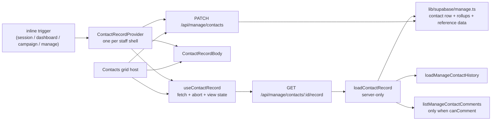

# Architecture Spine — Cross-surface contact record

The premium contact record exists, but it is welded to the Contacts grid. This spine makes it openable wherever a staff member sees a person, without letting the record become a general contact reader and without weakening the contact patch.

This reopens CAP-5's withdrawn record review as a cross-surface capability; `spec-contacts-premium-grid` is updated with a pointer in the same change.

## Design Paradigm

**One authorized record gateway, one record body, thin frames.**

A single server loader owns the full-record read and authorizes it at the contact RLS boundary. The HTTP gateway returns one capability-tagged payload. The client has one provider that opens, fetches, aborts and closes; one body renders the fields, history and comments; the desktop dialog and the phone frame only position and scroll. The Contacts grid keeps its own open state and mirror, but shares the body, the view state and the write channel.



## Inherited Invariants

| Inherited | From parent | Binds here |
| --- | --- | --- |
| AD-1 — patch owner resolved once at the staff boundary | `architecture-folk_hkmc-2026-11-03` | The provider and the record view never re-derive the supervisor or read `public.users`; `StaffContext` is the only identity. |
| AD-3 — one patch predicate, one actor/owner vector | `architecture-folk_hkmc-2026-11-03` | The record read and write use the contact patch predicate; the loader passes the staff context, never a page-built scope. |
| AD-4 — role sets and the surface matrix | `architecture-folk_hkmc-2026-11-03` | The record route uses `MANAGE_CONTACT_WRITE_ROLES`; a Volunteer never receives a trigger. |
| AD-5 — RLS grants the patch; a page may narrow it, never widen it | `architecture-folk_hkmc-2026-11-03` | The full record is manage-scope only. The existing session summary is a pre-existing wider read, recorded in AD-15 and not extended here. |
| AD-6 — the stored name and the UI label stay `Preacher` | `architecture-folk_hkmc-2026-11-03` | The record keeps the field label `Assigned Preacher`; no "supervisor" copy. |

## Invariants & Rules

### AD-7 — One full-record read model and one manage authorization boundary

- **Binds:** `lib/contacts/record.ts` (server-only); `lib/contacts/record-handlers.ts`; `apps/*/app/api/manage/contacts/[contactId]/record/route.ts`; `lib/supabase/manage.ts`; `lib/supabase/contact-comments.ts`
- **Prevents:** each surface inventing its own record fetch or authorizer; a session-context full-record endpoint widening contact RLS; two payload shapes that drift; a service-role full-row read before the scope check.
- **Rule:** `loadContactRecord({ staff, contactId })` is the only full-record read. It runs behind `getStaffContext()`, `requireRole(staff, MANAGE_CONTACT_WRITE_ROLES)`, and the contact RLS boundary. The full row is read with `createSupabaseServerClient()` (RLS), not the admin client; only after that read returns nothing may the existing service-role existence probe distinguish 403 (in programme, out of scope) from 404 (not in this programme). The only full-record HTTP surface is `GET /api/manage/contacts/[contactId]/record` in both apps; it is `force-dynamic`, `Cache-Control: no-store`, and returns the project's `{ error }` envelope. No **new** session-context full-record endpoint exists; the existing session summary is the AD-15 exception. The record hosts stop calling `GET /api/manage/contacts/history` and `GET /api/manage/contacts/comments`; the `/history` route is retired with the grid host switch, and the comments GET remains only for the mutation API and its tests, never as the record read (AD-9).
- **Payload:** `ContactRecordPayload` = `contact`, `locations`, `locationOptions`, `staffNames`, `booksReadOptions`, `sourceOptions`, `history`, `comments | null`, `capabilities`. `locations` is the programme naming set, read with the admin client as a reference read like `loadContactsSectionData`, so a current out-of-patch location is named; `locationOptions` stays the patch owner's set for the picker. `staffNames` is narrowed to the ids the record references, as `loadStaffDisplayNames` already does. `sourceOptions` is the known constant set plus the record's own source; `booksReadOptions` is the record's own books plus a scoped distinct read through the RLS client. None of these reads every contact.

### AD-8 — Capability flags are server-derived; the comments read is conditional

- **Binds:** `ContactRecordPayload.capabilities`; `components/contacts/use-contact-record.ts`; `components/contacts/contact-record-body.tsx`; `components/manage/contact-comments-pane.tsx`
- **Prevents:** a session page enabling edit; an Admin seeing a comments composer for a programme contact outside their patch; a record 403ing because the loader read comments unconditionally; a client inferring capability from `role` or from which page it is on.
- **Rule:** `capabilities.canEdit` is true for every manage-context record; the full record is not produced outside that boundary. `capabilities.canComment` is `contactInPatch(row.assigned_preacher_id, staff.patchOwner?.userId ?? null)` on the raw contact row, or `contactInPatch(contact.assignedPreacherId, ...)` after mapping — not a property that exists on both shapes. `loadContactRecord` calls `listManageContactComments` **only when `canComment` is true**; when false, it does not call the comments read, `comments` is `null`, and the presentational pane shows the reason. The comments module keeps `assertCommentContactInScope` unchanged; no one relaxes it to make the Admin-out-of-patch record work. An Admin may edit a programme contact outside their patch but cannot comment on it; that split is explicit.

### AD-9 — One record body with one view state; thin frames; the grid keeps its host

- **Binds:** `components/contacts/contact-record-body.tsx`; `contact-record-dialog.tsx`; `contact-record-phone.tsx`; `components/manage/manage-contact-list.tsx`; `components/manage/manage-contacts-table.tsx`; `components/manage/manage-contact-sheet.tsx`; `components/grid/grid-row-expand-control.tsx`; `components/grid/grid.tsx`
- **Prevents:** two record UIs drifting; the phone record staying a reduced copy without history or comments; the grid host and the provider carrying two data lifetimes; a rewrite of the 2,500-line Contacts grid; a second commit path; an unfrozen callback surface.
- **Rule:** `ContactRecordBody` takes one view state and one callback surface, and never fetches:
  ```
  type ContactRecordLoad<T> =
    | { status: "loading" }
    | { status: "error"; message: string }
    | { status: "ready"; value: T }

  interface ContactRecordViewState {
    contact: ManageContact
    locations: readonly ManageLocation[]
    locationOptions: readonly ManageLocation[]
    resolvers: ContactFieldResolvers
    sourceOptions: readonly string[]
    booksReadOptions: readonly string[]
    history: ContactRecordLoad<ManageContactHistory>
    comments: ContactRecordLoad<ManageContactCommentList> | null
    capabilities: { canEdit: boolean; canComment: boolean }
  }

  interface CommentActions {
    create(body: string, rootCommentId?: string | null): Promise<ManageContactComment>
    update(commentId: string, body: string): Promise<ManageContactComment>
    remove(commentId: string): Promise<void>
    react(commentId: string, emoji: string, active: boolean): Promise<void>
  }

  interface ContactRecordBodyProps {
    state: ContactRecordViewState
    onCommit?: (fieldId: ContactFieldId, value: unknown) => void | Promise<void>
    commentActions?: CommentActions | null
    onClose: () => void
    onPrevious: () => void
    onNext: () => void
    canGoPrevious: boolean
    canGoNext: boolean
  }
  ```
  `useContactRecord` returns one state and one action surface for both hosts:
  ```
  interface UseContactRecordResult {
    state: ContactRecordViewState | { status: "loading" } | { status: "error"; message: string }
    commit: (fieldId: ContactFieldId, value: unknown) => Promise<ManageContactWriteResult | null>
    applyWrite: (result: ManageContactWriteResult) => void
    comments: CommentActions | null
    close: () => void
    previous: () => void
    next: () => void
    canGoPrevious: boolean
    canGoNext: boolean
  }
  ```
  `commit` updates the hook's `viewState.contact` by spreading the result and returns the same `ManageContactWriteResult`; the grid host passes that result to its own `applyWrite`, so the hook and the mirror cannot diverge. The body's `onCommit` is a fire-and-forget wrapper over the host's `commit`; the host owns the error state.
  `ContactRecordBody` owns the field rows, the attendance and campaign sections and the comments layout. The comments pane is presentational: it receives `comments`, `canComment` and `CommentActions` from the host, and never reads on mount. The desktop dialog and the phone frame only position, scroll and supply header actions. The Contacts grid's desktop host (`manage-contacts-table.tsx`) and phone host (`manage-contact-list.tsx`, with the sheet in `manage-contact-sheet.tsx`) keep their own open state, mirror and sequence, and fetch the same bundle through `useContactRecord`; the same view state drives the body. The host merges a successful write result into both the hook's `viewState.contact` and the grid mirror via `applyWrite`/`handleListCommit`, so closing the record cannot leave a stale row (AD-10). The old `useContactHistory` self-fetch and the `GET /api/manage/contacts/history` route are retired when the grid host switches; the comments pane's self-fetch and the record's use of `GET /api/manage/contacts/comments` are retired in the same change. The location editor receives `locationOptions` (the patch owner's set); `locations` is only the resolver for a current out-of-patch location, which is named but not offered as a new selection.

  The campaign assign grid copies the Contacts grid's two routes: a leading `GridRowExpandControl` in the gutter for pointer and touch, and a row context menu item `Expand record` reached with Shift+F10 or the Menu key. The leading column widens to fit the serial/checkbox slot plus the expand slot; it is not a drop-in at the current 40px. The control is a real button labelled with the person's name, carries `data-grid-row-expand` for tests, stops propagation on pointerdown and click, and does not toggle row selection. It may keep the Contacts grid's `tabIndex={-1}` modality because the context menu is the keyboard route; making in-cell controls Tab-reachable would require fixing the grid's pre-existing Tab trap and is not part of this feature. The context menu is the required keyboard route, not an optional extra.

### AD-10 — One mutation channel

- **Binds:** `components/contacts/use-contact-record.ts`; `ContactRecordBody`; `components/manage/manage-contact-field-editor.tsx`; `components/manage/manage-contacts-table.tsx` (`handleListCommit`, `applyWrite`); `components/manage/manage-contact-list.tsx`; `lib/manage/api-handlers.ts`; `PATCH /api/manage/contacts`
- **Prevents:** a second PATCH path; optimistic state diverging between the grid and the provider; a read-only context writing; a merge that blanks fields the write result does not return; a grid row stale after a record edit.
- **Rule:** every record field write goes through `PATCH /api/manage/contacts` with `MANAGE_CONTACT_PATCH_KEYS`. The grid host's `handleListCommit` remains the grid cell and record commit path; the body's `onCommit` delegates to the host's commit. A host merges the write result by spreading it over the previous contact (`{ ...previous, ...result }`), never by enumerating the result's keys: `ManageContactWriteResult` omits `photoPath`, `lastContactedOn` and the rollups. The merge updates both the hook's `viewState.contact` and the grid mirror through `applyWrite`. A failed write re-reads the record, surfaces the server's message, and reverts the mirror. `canEdit: false` renders values, never editors; the full manage record is always editable, and the out-of-scope summary is a separate read-only component. No new write endpoint, no direct Supabase from a component, no second validation layer.

### AD-11 — One provider per staff shell, lazy and abortable

- **Binds:** `components/staff-auth-shell.tsx`; `components/contacts/contact-record-provider.tsx`; `lib/staff-dto.ts` (`ClientStaff.canReadContacts`); every trigger surface
- **Prevents:** every page mounting its own overlay and fetch; the heavy record in every initial bundle; a stale response overwriting a newer open; a Volunteer seeing a trigger; a provider that blanks the shell it wraps.
- **Rule:** mount `ContactRecordProvider` once inside `StaffAuthShell`'s `AuthProvider`. It always renders `children`; only the overlay is conditional. It gates on `ClientStaff.canReadContacts`; if auth refreshes to a staff member without that flag, it closes. The body and frames load through `next/dynamic` with `ssr: false` on first open. Each open owns one `AbortController`; closing or switching aborts it. The provider exposes `openContactRecord({ contactId, sequence?, trigger? })` and `close`. It never prefetches and never reads the full contact set. The grid host may keep its static imports; the provider is the lazy path.

### AD-12 — Inline triggers only, and only for in-scope contacts

- **Binds:** `components/sessions/session-attendees.tsx`; `session-attendee-table.tsx`; `session-attendee-cards.tsx`; `session-top-attendees-card.tsx`; `components/dashboard/focus-section.tsx`; `components/dashboard/candidates-route.tsx`; `components/campaign/assign-contacts-select.tsx`; `components/manage/manage-sessions-view.tsx`; `apps/*/app/manage/page.tsx`; `lib/contacts/record.ts`
- **Prevents:** a global contact finder growing out of this feature; an out-of-scope session attendee opening the full record; a trigger that 403s; a dead button; using the service-role client to compute availability; two availability rules for the same Admin.
- **Rule:** no global finder, no command palette, no URL deep link. A surface renders a trigger only when the contact is inside the manage contact scope:
  - **Session detail:** `SessionAttendee.recordAvailable` is computed by `loadContactRecordAvailability({ staff, contactIds })` in `lib/contacts/record.ts`, which uses `createSupabaseServerClient()` (RLS) to select the ids the caller may read. `false` keeps the existing summary modal; `true` opens the premium record.
  - **Sessions overview Top 5:** the same helper over `SessionTopAttendee` ids; `false` renders plain text.
  - **Manage Sessions pills:** the manage page computes availability with the same helper over the attendee ids and passes the set to the client. The payload's contact set is not a second availability rule; for an Admin in `mode=preacher` the helper follows the Admin's programme-wide contact RLS, which is exactly what the record endpoint allows.
  - **Dashboard Focus and Candidates, Campaign assign:** the row sets are server-scoped (dashboard scope / campaign scope) and equal contact scope; every row is a trigger. The record endpoint re-checks. No extra availability read.
  - **Campaign caller screens and the live attendance list:** no trigger.
  
  The session detail's summary remains the fallback; the premium record never replaces it for an out-of-scope attendee. If a trigger shown with `recordAvailable: true` still receives 403 because scope changed after render, the provider shows "This record is outside your contact scope" and closes; it does not silently fall back to the summary.

### AD-13 — The source list supplies the sequence

- **Binds:** `ContactRecordProvider`; `useContactRecord`; `manage-contacts-table.tsx`; `manage-contact-list.tsx`; every trigger surface
- **Prevents:** chevrons navigating to an out-of-scope record or to a different list; the desktop and phone hosts stepping through different sets; disabled chevrons looking broken; the provider inventing a global order.
- **Rule:** `openContactRecord` accepts `sequence?: readonly string[]` of in-scope contact ids in the source's display order. Previous/Next move only within that sequence; absent or singleton disables both. The provider never derives a sequence from a global contact read. Session detail passes the in-scope attendee ids; Dashboard Focus and Candidates pass the current list's ids; Campaign assign passes the visible in-scope rows; Top 5 passes the in-scope top five. Manage Sessions passes the current session's attendee ids filtered by availability, not every attendee across every session. `components/grid/grid.tsx` exposes the Grid's current filtered/sorted visible row ids to the host (an `onVisibleRowIdsChange` callback or equivalent); both grid hosts use that sequence, so the desktop cannot step through the unfiltered mirror and the phone cannot use a different filter. The host must not re-filter the raw rows itself.

### AD-14 — One overlay layer and focus contract

- **Binds:** `contact-record-dialog.tsx`; `contact-record-phone.tsx`; `ContactRecordProvider`; `manage-contacts-table.tsx`; `manage-contact-list.tsx`; `manage-contact-sheet.tsx`; `components/ui/dialog.tsx`
- **Prevents:** focus left on the page behind; one Escape closing two layers; a scrolling background; no focus return; two `aria-modal` frames owning the keyboard; the sheet closing with the record; Escape closing the record while an inline editor is open.
- **Rule:** the record frames mount inside the existing Radix Dialog primitive (`components/ui/dialog`) or one shared overlay stack with the same behaviour; no frame registers its own document keydown or scroll lock. The topmost layer owns Escape; `stopPropagation` on a sibling listener is not the mechanism. The dialog's `onEscapeKeyDown` yields when the event target is an editable control (`input`, `textarea`, `select`, `[contenteditable]`) or inside an open editor/popover: the field editor's Escape discards the draft, and the record stays open. The background is inert and scroll-locked. The desktop frame keeps its measured geometry inside `DialogContent`; the phone frame is a full-screen `DialogContent`. Every host, not only the provider, records its trigger: the row expand button on desktop, the sheet's "Expand contact" on phone, the inline trigger elsewhere. The phone sheet and the record share one layer stack; the sheet's Escape handler yields when the record handled it (`event.defaultPrevented` or the stack), so one Escape never closes both. On close, focus returns to the trigger if it is still connected, otherwise to the host's list/grid container (`[data-contact-list]`, `[data-grid-scroll]`) or a heading made focusable with `tabIndex={-1}`; never a plain `h1`. The frame carries `role="dialog"`, `aria-modal="true"` and an accessible name that includes the contact's name; the body's sections start at `h2`; stepping records updates the name and announces the new contact (`aria-live="polite"` or focus on the title). The session summary keeps its existing Radix Dialog; the stack closes only the top layer.

### AD-15 — The out-of-scope session summary is unchanged

- **Binds:** `components/sessions/session-attendees.tsx`; `components/sessions/contact-attendance-card.tsx`; `apps/folk/app/api/sessions/[sessionId]/attendees/[contactId]/route.ts`
- **Prevents:** the feature extending the session summary's wider read; deleting the fallback and leaving out-of-scope attendees with nothing; two summary UIs; a test suite that still asserts the summary for an in-scope Admin.
- **Rule:** an out-of-scope session attendee keeps the current summary modal and endpoint exactly as they are. The feature does not add comments, campaign history or edit to it. That summary's existing read is wider than contact RLS: `contact_attendance_summary` returns notes, favourite, location and assigned preacher for any attendee of a visible session. It is a pre-existing exception, recorded 2026-11-07 with Dwaraka as owner; this feature neither extends nor fixes it. The premium record never uses the session endpoint. The session detail's in-scope attendees (including every Admin, whose contact RLS is programme-wide) now open the premium record, so the existing `sessions-detail` assertions for the summary and the matrix rows S8/S9 change in the same story; add an out-of-patch Preacher fixture to cover the fallback.

### AD-16 — One record, one scoped read

- **Binds:** `loadContactRecord`; `useContactRecord`; `loadContactRecordAvailability`
- **Prevents:** every page that opens a record loading the full contacts payload; the record costing the grid's query; a hidden programme-wide read; availability computed through the service-role client.
- **Rule:** the record gateway reads one contact, its rollups, its history, its comments when allowed, and the reference data the pickers need. It must not call `loadContactsSectionData` or `loadManagePortalData`, and must not read every contact. `booksReadOptions` and `sourceOptions` are the record's own values plus constants or a scoped distinct query, never the full contact set. The source page's existing list read is unchanged; the provider fetches only on open. `loadContactRecordAvailability` is the only availability read, uses the RLS client, and returns a `Set<contactId>`.

## Consistency Conventions

| Concern | Convention |
| --- | --- |
| Naming | `ContactRecordPayload`; `ContactRecordViewState`; `ContactRecordLoad<T>`; `CommentActions`; `UseContactRecordResult`; `loadContactRecord`; `loadContactRecordAvailability`; `useContactRecord`; `openContactRecord`; `ContactRecordProvider`; `ContactRecordBody`; `ContactRecordDialog`; `ContactRecordPhoneFrame`; `recordAvailable`; `canEdit`; `canComment`; `onVisibleRowIdsChange`. |
| Data & formats | Contact ids are UUIDs. `capabilities` is server-derived and always present. `comments` is `ContactRecordLoad<ManageContactCommentList> \| null`. `history` is `ContactRecordLoad<ManageContactHistory>`. `recordAvailable` is a boolean computed by the RLS client, never by a client heuristic. `data-grid-row-expand` marks the campaign grid's pointer/touch expand control for tests. The record GET is `no-store`. |
| State & cross-cutting | One provider per staff shell; one `useContactRecord` hook and one view state per host; `commit` returns the write result and the host passes it to `applyWrite`; one fetch per open; abort on close/switch; no prefetch; lazy chunk; one overlay layer; focus capture and restore; no global finder; no new session-context full record. |
| Authorization | The record route uses `getStaffContext()` + `MANAGE_CONTACT_WRITE_ROLES` + the contact RLS boundary. The full row is read with the RLS client; the service-role probe only distinguishes 403/404 after an empty RLS read. Comments use `contactInPatch`; the loader skips the comments read when false. No new role list, no page-built scope. |
| Error shapes | The record gateway returns the project's existing `{ error }` envelope. The provider shows loading, not-found, forbidden or failed states. A 403 is never rendered as an empty record. |

## Stack

Repo pins, verified from `package.json`; this feature adds no dependency.

| Name | Version |
| --- | --- |
| Next.js | 16.0.7 |
| React | 19.2.0 |
| TypeScript | 5.x |
| Tailwind CSS | 4.1.9 |
| @supabase/supabase-js | ^2.105.1 |
| @tanstack/react-table | ^8 |
| @tanstack/react-virtual | ^3 |
| Playwright | ^1.62 |
| Vitest | ^5.0.5 |
| pnpm | 10.33.0 |

## Structural Seed

```text
lib/contacts/record.ts                          # server-only read model, availability helper, payload assembly
lib/contacts/record-handlers.ts                 # GET handler: staff + role + contact boundary
apps/*/app/api/manage/contacts/[contactId]/record/route.ts
components/contacts/contact-record-types.ts     # client-safe payload, view state, load state
components/contacts/use-contact-record.ts       # fetch + abort + view state (provider and grid host)
components/contacts/contact-record-provider.tsx # one host: open, sequence, trigger, focus
components/contacts/contact-record-body.tsx     # fields + history + comments layout; never fetches
components/contacts/contact-record-dialog.tsx   # desktop frame, moved from components/manage
components/contacts/contact-record-phone.tsx    # phone frame, replaces the grid-only record
components/contacts/contact-record-trigger.tsx  # inline button wrapper + trigger ref
components/manage/contact-comments-pane.tsx      # presentational: comments + mutation callbacks
components/manage/manage-contact-sheet.tsx       # phone sheet; Escape yields to the record
components/grid/grid-row-expand-control.tsx     # generic leading-gutter pointer/touch expand control
components/grid/grid.tsx                        # exposes visible row ids; row context menu
components/staff-auth-shell.tsx                 # mounts the provider
components/sessions/session-attendees.tsx       # recordAvailable fallback branch
components/dashboard/focus-section.tsx          # inline triggers
components/dashboard/candidates-route.tsx       # inline triggers
components/campaign/assign-contacts-select.tsx  # expand control + context menu + widened leading column
components/manage/manage-sessions-view.tsx      # attendee pills + availability set
apps/*/app/manage/page.tsx                      # computes availability for the manage payload
lib/sessions/data.ts                            # attendee ids; recordAvailable attached by the page
```

## Capability → Architecture Map

| Capability / Area | Lives in | Governed by |
| --- | --- | --- |
| One full-record read + payload | `lib/contacts/record.ts`, manage record route | AD-7, AD-16 |
| Read/edit/comment capabilities | `ContactRecordPayload.capabilities` | AD-8 |
| Shared body, view state, frames | `components/contacts/contact-record-*` | AD-9, AD-14 |
| Grid host preserved; history/comments no longer self-fetch | `manage-contacts-table.tsx`, `manage-contact-list.tsx`, `manage-contact-sheet.tsx` | AD-9, AD-10, AD-14 |
| Record writes | `PATCH /api/manage/contacts` | AD-10 |
| Provider mount, lazy load, abort | `components/staff-auth-shell.tsx` | AD-11 |
| Inline trigger surfaces | sessions, dashboard, campaign assign, manage sessions | AD-12, AD-13 |
| Out-of-scope session fallback | `ContactAttendanceCard`, session attendee endpoint | AD-15 |
| Campaign assign expand | `GridRowExpandControl` + row context menu | AD-9, AD-12 |
| Availability read | `loadContactRecordAvailability` | AD-12, AD-16 |

## Deferred

- **Global contact finder / command palette.** Not in this feature; it would create a general contact reader, which is exactly what AD-12 avoids. Revisit only with its own authorization and search design.
- **URL deep link (`?contact=<id>`).** The record is an overlay on a list, not a route; a URL would need its own authorization and back-button contract. The existing "Copy contact URL" affordance is unchanged and still unconsumed.
- **Converging the Contacts grid host onto the provider.** The grid keeps its own open state, mirror and sequence; both use `useContactRecord` and the same body state. Converge only if a third host makes the duplication cost real.
- **A second record affordance in Manage Attendance and Manage Favorites.** Those views already have their own selected-detail panels; adding the premium card there is a UI decision, not a gap.
- **Campaign caller screens.** Deliberately excluded: a caller in a call flow should not be opening a full record, and a Volunteer caller has no contact read. Add only with a caller-specific decision.
- **Narrowing the existing session summary.** The summary endpoint already reads wider than contact RLS (notes, favourite, location, attendance). This feature does not extend it and does not fix it. Owner: Dwaraka; recorded 2026-11-07. Narrow it only as its own security change with its own decision.
- **Server-side record caching or prefetch.** Not needed at this size; the record is one read on open. Revisit only if the read costs become visible.
- **A route-based record page.** The phone frame is an overlay, not a page. A real URL and back-button model are a separate routing design.
