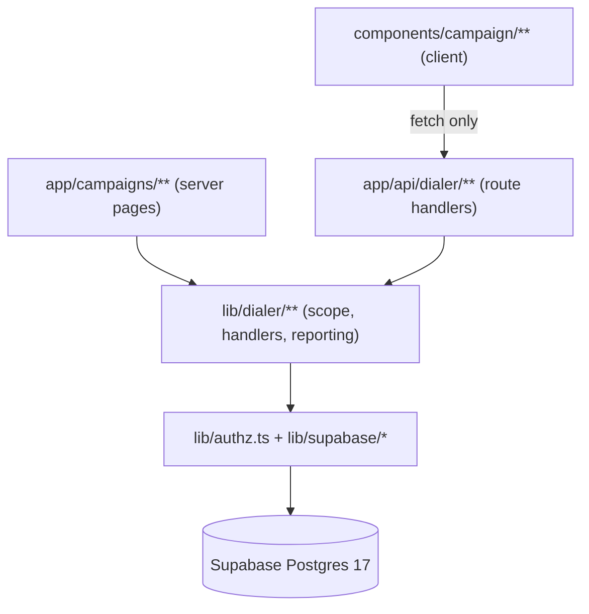
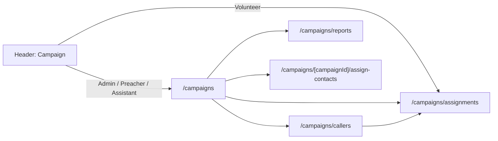
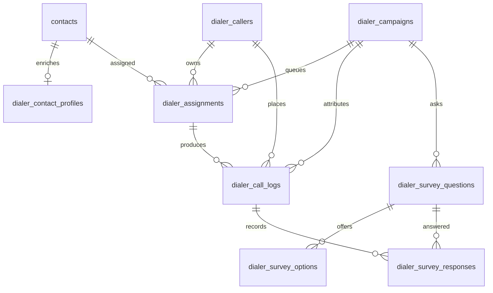
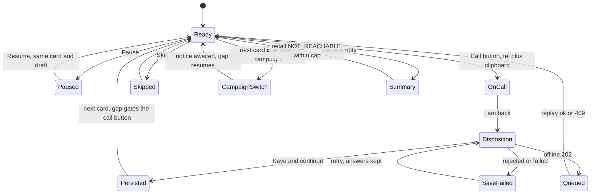

# Architecture Spine — FOLK Autodialer

The consistency contract for the Campaign surface. Decisions only; the reasoning lives in `.memlog.md`, the narrative in `architecture.md`, the tables in `data-model.md`.

## Design Paradigm

**A server-gateway slice inside the layered App Router monolith.** The dialer is one vertical slice with a single door:

- `apps/folk/app/campaigns/**` — server pages compose admin payloads; the caller session is a client shell on one of those pages.
- `apps/folk/app/api/dialer/**` — route handlers. The browser's only dialer network edge.
- `lib/dialer/**` — scope assertions, request handlers, reporting. Server-only.
- `lib/authz.ts`, `lib/supabase/*` — the inherited staff and persistence layer.
- Supabase Postgres — RLS, one transactional disposition function.



The dependency rule is the paradigm: **pages and route handlers may import `lib/dialer`; `lib/dialer` may import `lib/authz` and `lib/supabase`; neither of those may import `lib/dialer`.** A client component imports neither a server client nor `lib/dialer` — it calls a route handler.

Inherited, not re-decided here: `program_id` on every row, service-role-only writes, RLS through `caller_role()` / `caller_program_id()` / `caller_assigned_preacher_id()`, `@/*` imports, the manual-form pattern (`useState` + `fetch`, no `react-hook-form` or `zod`), and `pnpm test:static` / `pnpm guardrails` as the real gates because `next build` ignores type errors.

## Invariants & Rules

### AD-1 — Campaign is one route tree, and the caller session is inside it

- **Binds:** CAP-1, CAP-6, CAP-9; nav, the app-level `proxy.ts` matchers, the root `public/sw.js`
- **Prevents:** a second entry point for callers; a route outside the session-refresh matcher; a Volunteer surface the nav cannot reach; gita-life inheriting the feature by accident.
- **Rule:** every Campaign route lives under `/campaigns/**`. The caller session is exactly `/campaigns/assignments`; the admin batch grid is `/campaigns/[campaignId]/assign-contacts`; campaign detail, edit and the survey builder live at `/campaigns/[campaignId]`; creation is a child of the same prefix. `/dialer` does not exist in either app. The matcher that Next reads is the **app-level** `apps/folk/proxy.ts` and `apps/gita-life/proxy.ts`; both gain `/campaigns/:path*` and `/api/dialer/:path*` (the root `proxy.ts` only exports the handler, so a root-only edit refreshes nothing). The service worker is one file: `apps/*/public` are symlinks to the root `public/`, so `/campaigns` goes into `NETWORK_ONLY_PATH_PREFIXES` in the root `public/sw.js` and is served by both apps. The API namespace stays `/api/dialer/**` even though the browser route is `/campaigns/**`.

### AD-2 — Three roles on the admin surface, one role on the caller surface

- **Binds:** CAP-1, CAP-4, CAP-5, CAP-8, CAP-9; `components/header.tsx`, every Campaign page and API
- **Prevents:** a Volunteer reaching Overview, Callers, Reports or the assign grid by URL; a new admin sub-route shipping without a gate; nav and page disagreeing about who may see what.
- **Rule:** `requireCampaignAdmin(staff)` is `requireRole(staff, ["Admin", "Preacher", "Assistant"])` and guards every admin Campaign page and every handler under `/api/dialer/admin/**`. `/campaigns/assignments` and every handler under `/api/dialer/caller/**` call `requireDialerCaller(staff)`, which resolves the `dialer_callers` row and refuses an inactive caller. The API is split by population so the gate is structural, not remembered. The header's Campaign item is rendered for every Admin, Preacher and Assistant whether or not they hold a caller profile — href `/campaigns` — and for a Volunteer only when they have an active `dialer_callers` row, href `/campaigns/assignments`. The Campaign sub-nav includes Assignments only when the signed-in staff member has an active caller profile, so an admin who is not a caller never sees a dead link and a Volunteer who is not a caller never reaches a 403. The three admin roles' Campaign item is their admin entry, not a caller flag. `modules.dialer` gates the single header item, which feeds both the desktop pill and the phone bottom nav. **The dialer has no invite flow of its own:** there is no `/campaigns/**` or `/api/dialer/**` invite route, no "invite caller" concept, no `Import roster`, and no add-person control on the Callers screen. Callers are existing staff users promoted to a `dialer_callers` profile; adding a person is the app's one staff invite path, outside the Campaign surface. The roster is scoped by AD-3. Deactivation is the dialer-level `is_active` switch and remains an Admin action.

### AD-3 — Campaign reads are preacher-scoped, through one helper

- **Binds:** CAP-4, CAP-5, CAP-8; every Campaign count, list, leaderboard and export
- **Prevents:** a Preacher seeing another preacher's contacts or outcomes; two screens computing different denominators from the same campaign.
- **Rule:** `campaignScope(staff)` returns `{ kind: "program" }` for Admin, `{ kind: "preacher", userId: staff.userId }` for Preacher, and `{ kind: "preacher", userId: staff.assignedPreacherUserId }` for Assistant. **A Preacher or Assistant with no scope id is refused with 403 — it never falls back to program scope.** It also returns the **assignable caller set**: Admin = every active staff user in the program; Preacher = active staff users whose `public.users.assigned_preacher_id = staff.userId`, **plus the Preacher themselves**; Assistant = active staff users whose `assigned_preacher_id = staff.assignedPreacherUserId`, **plus themselves**. A user with an existing `dialer_callers.is_active = false` profile is excluded — assignment never reactivates a deactivated caller. A caller outside the set is neither offered nor accepted. Campaign and survey-question rows are program-level and readable by all three roles; every count, funnel, leaderboard, contact-linked list and export applies the scope predicate to the assignment's contact. The app assertion is the enforcement, because the service-role client bypasses RLS; the dialer RLS policies replicate the same predicate as defence-in-depth for authenticated reads. No page, handler or export invents its own filter.

### AD-4 — One caller-written status; the reporting group is generated

- **Binds:** CAP-7, CAP-8; `dialer_call_logs`, the disposition RPC
- **Prevents:** a call outcome and a follow-up status contradicting each other; a report recomputing the mapping differently; a caller choosing a group.
- **Rule:** `dialer_call_logs.disposition_status` is the only status the caller writes, carrying the design's 13 chips. `status_group` is `GENERATED ALWAYS AS (CASE ...) STORED`; the RPC, the client and the types never accept or write it. There is no `call_outcome` column and no `follow_up_status` column.

| Stored `disposition_status` | Generated `status_group` |
| --- | --- |
| `CONFIRMED` | `CONFIRMED` |
| `MAY_COME` | `MAY_COME` |
| `WILL_COME_NEXT_CLASS`, `WILL_COME_NEXT_WEEK`, `VISITING_HOME_TOWN`, `CALL_ME_BACK`, `HEALTH_IS_NOT_GOOD`, `OUT_OF_STATION`, `BUSY_CANNOT_COME` | `DEFERRED` |
| `CALL_DID_NOT_CONNECT`, `SWITCHED_OFF` | `NOT_REACHABLE` |
| `WRONG_NUMBER` | `WRONG_NUMBER` |
| `NOT_INTERESTED` | `NOT_INTERESTED` |

The `CASE` is total and `status_group` is `NOT NULL`: a `disposition_status` with no group is a migration error, asserted by a check that the 13 stored values map to exactly the six groups above. A call that reached a conversation is any group except `NOT_REACHABLE` and `WRONG_NUMBER`. Campaign survey questions render only for a reached call; notes render always.

### AD-5 — Reporting definitions are computed once

- **Binds:** CAP-8; the funnel, campaign table, session summary, leaderboard and CSV
- **Prevents:** the same campaign reporting different numbers on four screens; a stalled volunteer looking like bad luck.
- **Rule:** one `campaign_progress(campaign_id, scope_preacher_id, program_scope)` function — `SECURITY INVOKER`, `EXECUTE` revoked from `PUBLIC`, `anon` and `authenticated` and granted to `service_role` — returns the funnel, the outcome mix by `status_group`, the per-caller rollup, the skipped / wrong-number / closed-after-cap counts the session summary needs, and the recent-activity rows. A `program_scope = false` with a null `scope_preacher_id` raises rather than widening; only an Admin passes `program_scope = true`. The function takes the AD-3 scope as an argument because the service-role client bypasses RLS, so the screen, the summary and the CSV cannot diverge. Definitions: **Attempted** = assignments with at least one call log; **Reached** = assignments with at least one log whose group is neither `NOT_REACHABLE` nor `WRONG_NUMBER`; **Confirmed** = the latest reached log has `disposition_status = 'CONFIRMED'`; **Never attempted** = assigned minus attempted; **Completed attempts** (leaderboard) = call logs by that caller in the campaign, any status. Funnel and campaign counts are assignment-grain; the leaderboard and recent activity are log-grain. A queued disposition is not counted until its replay lands. The leaderboard ranks completed attempts only and claims no quality signal.

### AD-6 — Disposition is one transaction, service-role only

- **Binds:** CAP-7; `record_call_disposition`
- **Prevents:** a half-written survey that a retry can never repair; a definer function bypassing the grants that protect it; a caller id taken from the payload.
- **Rule:** `record_call_disposition(...)` is `SECURITY INVOKER`. `EXECUTE` is revoked from `PUBLIC`, `anon` and `authenticated` and granted to `service_role` only. It re-reads the assignment in the transaction, **refuses when `dialer_callers.is_active` is false**, and writes the call log — including `dial_phone`, snapshotted from the contact — its survey responses and the assignment status together; the caller id comes from `getStaffContext()`; the write is idempotent on `(assignment_id, attempt)`. `attempt` is supplied by the queue payload and accepted only when it is the assignment's next attempt or an existing attempt owned by the same caller — the function never invents it. `called_at` is set on insert and never updated on replay. A replay of the same payload that finds the row returns `200`; a different payload for the same attempt returns `409` and changes nothing; it never returns `500`, which would stall the queue. The function rejects a choice question with no options and enforces `is_required`.

### AD-7 — The caller boundary is asserted, never implied

- **Binds:** CAP-1, CAP-6, CAP-7; every queue, card, history and disposition read
- **Prevents:** a caller enumerating another caller's queue; a deactivated caller writing; a failure path returning a usable partial row.
- **Rule:** `assertCallerAssignmentInScope(staff, assignmentId)` is the only path to a queue payload, call card or contact history. It resolves `dialer_assignments → dialer_callers` by `dialer_assignments.caller_id = dialer_callers.id`, `dialer_callers.user_id = staff.userId` and `program_id = staff.programId`; a caller row alone is never enough. It returns the scope row or throws `404` for both a missing assignment and another caller's assignment, and never returns a row on failure. The admin surface may keep the 403/404 distinction; the caller path does not. The browser never receives a general contacts read and never learns an id it was not given. `dialer_callers.is_active` is checked on the write path, not only in the assign picker. A refusal is a named state, not a generic save failure: cross-tab refused, caller deactivated, assignment reassigned and campaign cancelled each render an explicit blocking message, and the session pauses without discarding answers. The denial test includes a non-owning caller receiving `404` with no payload and an inactive caller receiving the named refusal.

### AD-8 — Route coverage is a guardrail, not a memory

- **Binds:** CAP-1, CAP-6, CAP-7; the security boundary
- **Prevents:** a new `/api/dialer` endpoint shipping without a denial test, and the single boundary test going stale because CI never runs e2e.
- **Rule:** `scripts/verify-dialer-route-coverage.mjs` runs inside `pnpm guardrails`. It enumerates every route file under `apps/folk/app/api/dialer/**` and fails when one has no row in the denial sweep. The sweep itself is an e2e spec asserting three cases per row: unauthenticated refused, a non-owning caller receives `404` with no payload, the owning caller succeeds. CI sees the static check; the behavioural sweep is a `pnpm test:e2e` gate before merge.

### AD-9 — The session is client state

- **Binds:** CAP-6, CAP-7
- **Prevents:** two tabs doubling every campaign number; a throttled timer drifting mid-call; a reload losing the contact the caller was on.
- **Rule:** there is no server-side session. The queue is one scoped snapshot, paged server-side per AD-16 and rendered as a virtualised window with an honest `Showing X of Y` count; position lives in `/campaigns/assignments?campaign=<id>` plus a re-fetch of remaining assignments. The gap is per campaign (5–300 seconds, admin-settable; a value outside the presets renders as the current value), gates the call button rather than navigation, and is derived from `Date.now()` against a target timestamp, never a decrementing counter. Pause, Skip and the awaited campaign-switch notice (which pauses the gap) are reachable from every live state; resume restores the same card and the in-flight draft. There is no desktop caller layout: a wide viewport gets the phone-first session or an explicit open-on-phone state, never a second design. `unique (assignment_id, attempt)` is the real single-session guarantee; a `BroadcastChannel` lock with a `localStorage` fallback refuses a second tab and says why.

### AD-10 — Offline is the disposition write, not the app shell

- **Binds:** CAP-7; the PWA and service worker
- **Prevents:** a false `Save failed` on a network gap; the dialer queue capturing attendance, registration or contact traffic; a duplicated disposition after replay.
- **Rule:** `/api/dialer/caller/disposition` joins `QUEUED_POST_PATHS` and `/campaigns` joins `NETWORK_ONLY_PATH_PREFIXES` in the root `public/sw.js` that both apps serve through their symlinked `public/` directories. The endpoint is idempotent on `(assignment_id, attempt)`; `sw.js` drains on `ok || 409`. A network gap produces `Queued — will send` (a success state); a rejected or failed write produces `Save failed — session paused`, keeps the answers and pauses the session. A permanent refusal on a replayed row — reassigned, deactivated, campaign cancelled — returns `409` so the frozen queue drains; the localStorage draft remains the recovery record and the next session surfaces it as a call that could not be saved. The draft is keyed `dialer:disposition:<assignmentId>:<attempt>` and discarded when either changes or the write is confirmed. A queued disposition is not counted in reporting until its replay lands. No app-shell offline behaviour is promised: the tab must already be open.

### AD-11 — Assignment is a move, and weights are write-time only

- **Binds:** CAP-5; `dialer_assignments`
- **Prevents:** one contact owned by two callers in one campaign; a weights table becoming a second source of truth; a partially written batch.
- **Rule:** `unique (contact_id, campaign_id)` — never the source app's three-column key. A campaign's target audience is a selection-time facet over `dialer_contact_profiles`; no `audience_filter` is stored. A batch request carries `contactIds[]`, `campaignId` and `[{callerId, weight}]`; every selected contact must be in the assigner's AD-3 scope, and every destination caller must be an active staff user in the assigner's **assignable caller set** (AD-3). An Admin may assign across the program; a Preacher may assign only their own contacts to the callers assigned to them **or to themselves**; an Assistant does the same for their preacher **or themselves**. Assigning an eligible staff user creates their `dialer_callers` profile if it does not exist (auto-promote); an existing inactive profile is refused, never reactivated. No separate invite or promote step gates the assignment. A caller outside the set is rejected by name, not silently dropped. The caller still sees only their own assignments, never a general contact read. **Pre-check:** the server names every selected contact already assigned in the campaign; the admin chooses *skip them* (assign only the unassigned) or *move them* (reassign to the new split). Nothing is written until that choice. **Write:** one transaction re-runs the pre-check on the same selection, inserts exactly the confirmed set, computes `N` from it, distributes by floor division plus largest remainder, and writes only the resulting rows. No weight is stored. There is no partial success: a failure rolls the whole batch back and reports the offending rows by name.

### AD-12 — History survives campaign and question changes

- **Binds:** CAP-2, CAP-8; campaigns, questions, recall
- **Prevents:** a cascade delete destroying a live queue or historical answers; an unbounded recall loop.
- **Rule:** a campaign is created in `DRAFT` and moves only through `DRAFT → ACTIVE`, `ACTIVE → COMPLETED`, `ACTIVE → CANCELLED` or `DRAFT → CANCELLED`; `COMPLETED` and `CANCELLED` are terminal in v1 and no transition is automatic. The three Campaign admin roles may perform the transitions. Assignments and the survey may be prepared while `DRAFT`; the queue offers only `PENDING` assignments on an `ACTIVE` campaign, and a disposition, Skip or recall against any other status returns a terminal `409`. Campaigns are cancelled (`status = 'CANCELLED'`), never deleted; a survey question with responses is retired (`retired_at`), never deleted. No endpoint deletes either, and `DELETE` is not granted to any role. `dialer_assignments.contact_id`, `dialer_assignments.caller_id`, `dialer_call_logs.caller_id` and `dialer_callers.user_id` are `ON DELETE RESTRICT`: a contact or staff identity with dialer history cannot be deleted, because the cascade would destroy the calls; `/manage` maps the restriction to its existing 409 shape. Assignment status is one of `PENDING`, `COMPLETED`, `SKIPPED`. The queue offers `PENDING` rows on `ACTIVE` campaigns. The RPC sets `COMPLETED` for every saved disposition and `SKIPPED` for Skip; a deferral records the reason but does not re-queue, and there is no follow-up date or `SCHEDULED` state in v1. Every transition is a conditional update on the current status, so a lost race returns `409` and never double-counts. Recall returns only `NOT_REACHABLE` `COMPLETED` rows to `PENDING`, without bumping anything — the next disposition is the next attempt. The cap (`max_attempts`, default 3) counts call logs; at the cap the summary says *closed after N attempts*. The survey builder ships: a choice question with no options is rejected, and `is_required` is enforced by AD-6.

### AD-13 — `contacts` stays the only contact universe

- **Binds:** CAP-3, CAP-4, CAP-6
- **Prevents:** a second contacts table; the core contacts policy depending on dialer tables; speculative programme data entering the shared table.
- **Rule:** no new column on `contacts`, and no Volunteer term added to its RLS policy. Calling enrichment is four nullable fields in `dialer_contact_profiles` (`centre`, `level`, `gender`, `language`); a contact without a profile row is fully callable. Contact create and update stay in `/manage`, with their handlers under `/api/manage/contacts/**` and the same `requireRole(staff, ["Admin", "Preacher"])` gate; the Campaign surface never owns a contact write. Contact CSV import and export are not in v1: there is no batch contact route, no 45-header contract, and no download control. The source app's CSV paths are deferred to a future Manage-contacts change. Callers are existing `public.users` rows plus a `dialer_callers` profile. The dialer creates no `public.users` and no `auth.users`: an eligible staff user is promoted to a caller profile on first assignment, and adding a person is the app's single staff invite path, outside the Campaign surface. A `users` row without a matching `auth.users` row cannot sign in, so a bare-row path does not exist.

### AD-14 — Program scope and program absence

- **Binds:** all capabilities
- **Prevents:** a cross-program read; gita-life inheriting the feature; the module flag becoming an authorization gate.
- **Rule:** `program_id TEXT NOT NULL` on every dialer table; RLS through the existing helpers on every table; every handler asserts the program before reading or writing. No Campaign route, page or API exists under `apps/gita-life`. `modules.dialer` hides the shared header item only and is never the authorization decision.

### AD-15 — No new runtime service

- **Binds:** all capabilities; deployment and operations
- **Prevents:** a cron, queue worker or telephony provider appearing for recall, export or pacing; a provider key reaching the client bundle.
- **Rule:** the feature runs on the existing Next.js runtime and Supabase only. No cron, no job queue, no worker, no telephony provider and no new external API in v1. Recall and export are request-time user actions. Credentials are read only through a server-only module modelled on `lib/supabase/env.ts`; `turbo.json` build env is not widened.

### AD-16 — Every dialer list read pages, and fails loudly

- **Binds:** CAP-3, CAP-5, CAP-8; every list and export
- **Prevents:** silent truncation at PostgREST's 1,000-row cap on a program holding about 1,030 contacts.
- **Rule:** one shared pager, extracted from the existing `collectPagedRows` in `lib/supabase/manage.ts`, concatenates pages and throws when its page budget is exhausted rather than returning a short list. Every dialer list read and export uses it; a bare `.range()` loop without the truncation check is a defect.

## Consistency Conventions

| Concern | Convention |
| --- | --- |
| Browser routes | `/campaigns/**` only. Caller session `/campaigns/assignments`; batch grid `/campaigns/[campaignId]/assign-contacts`. |
| API routes | `/api/dialer/caller/**` (any active caller) and `/api/dialer/admin/**` (Admin/Preacher/Assistant); `export const dynamic = "force-dynamic"`, thin delegate over `lib/dialer/api-handlers.ts`. |
| Server modules | `lib/dialer/scope.ts`, `api-handlers.ts`, `admin.ts`, `reporting.ts`; `import "server-only"` on each. |
| Components | `components/campaign/**` for the admin surface and the caller session; no dialer logic in `components/manage/**`. |
| Tables | `dialer_` prefix; `program_id TEXT NOT NULL`; `uuid` primary keys; `timestamptz`; `updated_at` via `set_updated_at()` — `dialer_call_logs` is exempt: it has `called_at` and no `updated_at`. |
| Enum values | `SCREAMING_SNAKE` in a `text` column with a `CHECK`, never a PostgreSQL enum; one hand-written union in `lib/dialer/types.ts` mirrors the check and is asserted against it. |
| Status vocabulary | `disposition_status` for the stored chip; `status_group` for the generated bucket; never `call_outcome` or `follow_up_status`. |
| Errors | `AuthzError` plus `authzErrorResponse`; `403` and `404` never carry a row. |
| Offline envelope | `202 { success: false, queued: true, message }`, matching the existing service-worker contract. |
| Mutations | Service-role only, after a scope assertion. No client-side Supabase write anywhere. |
| Imports and quotes | `@/*` alias; double quotes in app and feature code, single quotes only in generated `components/ui/*`. |
| Forms | `useState` plus hand-written handlers plus `fetch`; no `react-hook-form` or `zod` for this feature. |
| Empty states | Every empty state names the next action — create a campaign, ask an admin, widen the filter. Never a screen of zeroes. |
| Schema change | One timestamped migration; the matching `rls-policy-matrix.md` row in the same commit; `lib/supabase/types.ts` regenerated. |
| Tests | `e2e/specs/campaign-*.spec.ts`; `getByRole` first; per-role `storageState`; one runner at a time. |

## Stack

| Name | Version |
| --- | --- |
| Next.js | 16.0.7 (repo pin; 16.4.3 is current — see Deferred for the patch-level risk) |
| React | 19.2.0 |
| TypeScript | 5.7.3 |
| Tailwind CSS | 4.1.9 |
| PostgreSQL | 17 |
| Supabase CLI | 2.98.2 |
| Playwright | 1.62.0 |
| Turborepo | 2.9.18 |
| pnpm | 10.33.0 |

## Structural Seed

```text
apps/folk/
  app/campaigns/                 # overview, assignments, callers, reports, [campaignId]/assign-contacts
  app/api/dialer/caller/        # queue, disposition, history
  app/api/dialer/admin/         # campaign, caller, assignment, report, export mutations
  public/sw.js                   # network-only /campaigns + queued /api/dialer/caller/disposition
components/campaign/             # admin views + caller session shell
lib/dialer/                      # scope assertions, handlers, reporting (server-only)
supabase/migrations/             # dialer tables, generated status_group, RPC, RLS
e2e/specs/campaign-*.spec.ts     # behaviour
e2e/specs/dialer-route-sweep.spec.ts
scripts/verify-dialer-route-coverage.mjs
```







| Environment | App | Data | Path |
| --- | --- | --- | --- |
| Local | `pnpm dev:local` — folk on 3000, gita-life on 3001 | Supabase local, PostgreSQL 17, Mailpit | `pnpm supabase:push`, `pnpm seed:local` |
| Preview | Vercel per app via `deploy:*:preview` | Hosted Supabase | not a test target; e2e is loopback-only |
| Production | Vercel per app | Hosted Supabase | owner-controlled; never deployed from this feature's work |

No new infrastructure, provider or scheduled job is introduced. The only network edges are the browser to the Next.js app, the app to Supabase, and a `tel:` handoff to the native phone app.

## Capability → Architecture Map

| Capability | Lives in | Governed by |
| --- | --- | --- |
| CAP-1 caller queue access | `/campaigns/assignments`, `lib/dialer/scope.ts` | AD-1, AD-2, AD-7, AD-14 |
| CAP-2 campaigns and survey | `/campaigns`, `/campaigns/[campaignId]`, `dialer_campaigns`, `dialer_survey_*` | AD-12, AD-14, AD-16 |
| CAP-3 contact universe | existing `/manage` contacts plus `dialer_contact_profiles` | AD-13, AD-16 |
| CAP-4 caller roster | `/campaigns/callers`, auto-promote on assignment, `dialer_callers` | AD-2, AD-3, AD-7, AD-13 |
| CAP-5 batch assignment | `/campaigns/[campaignId]/assign-contacts`, `dialer_assignments` | AD-3, AD-11, AD-16 |
| CAP-6 call session | `/campaigns/assignments`, `components/campaign/*` | AD-1, AD-7, AD-9, AD-10 |
| CAP-7 disposition | disposition screen, `record_call_disposition`, `dialer_call_logs` | AD-4, AD-6, AD-7, AD-10 |
| CAP-8 reporting and export | `/campaigns/reports`, `campaign_progress`, CSV handler | AD-3, AD-5, AD-16 |
| CAP-9 intuitive by default | header, sub-nav, empty states, receipts | AD-1, AD-2, AD-9, AD-10 |
| Security boundary | `lib/dialer/scope.ts`, denial sweep | AD-7, AD-8, AD-14 |

## Deferred

- **CAP-10 campaign assistant** — v2. If it ships, typed server-validated tools; the database is never a SQL string target.
- **CAP-11 member RSVP** — cut; `disposition_status` already records what an RSVP would.
- **Telephony provider (option B)** — possible without reshaping the session; adds cost, webhooks, a scheduler and `call_duration`.
- **App-shell offline** — the queue covers a dropped save, not a cold load with no network.
- **Import roster** — out of v1 and removed from the design; callers are existing staff users promoted on assignment, and adding a person is the core staff invite path.
- **Phone admin contact grid** — assignment stays desktop-only.
- **Audit trail for campaign and survey edits** — not required for v1; the call log is append-only.
- **SMS, WhatsApp or email reminders** — out of scope; recall is a session action.
- **Dialer in gita-life** — route absence is the v1 answer; adding it later is a route-plus-seed change.
- **Enforcing `modules.dialer` beyond the header** — the flag stays presentation-only.
- **Survey builder drag-and-drop** — the builder ships; drag-and-drop is a UX detail, not an architectural one.
- **No native client** — a browser app and PWA only; a tablet uses the phone layout.
- **No auto-created campaign** — a blocked admin gets a one-click empty state instead of a silent default.
- **No call recording, transcription or import** — voice calls only.
- **The Flutter autodialer is untouched** — additive work in `folk_hkmc`.
- **No dynamic SQL, ever** — a CAP-10 assistant selects named tools with server-validated arguments; the database is never a SQL string target.
- **Contact CSV import/export** — deferred to a future Manage-contacts change. V1 reuses existing `contacts` rows and has no batch contact route or CSV column contract.
- **Open — the exact create/edit URL** — a child of `/campaigns`; the prefix and its gate are the binding part.
- **Open — framework patch level** — Next 16.0.7 is behind 16.4.3 and affected by CVE-2026-44575 (middleware/proxy bypass, fixed in 16.2.5). The dialer does not rely on the proxy for authorization — every page and handler calls `getStaffContext()` — so this feature is not exposed by it, but the framework upgrade is a separate repo change and should be scheduled before production exposure.
